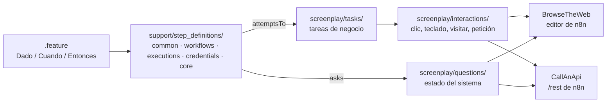

# VyV · Plan de pruebas de n8n · Módulos 1–4

Esta carpeta contiene todas las pruebas automatizadas del **plan de pruebas de n8n-VyV** (carpeta «Final VyV»: plan, casos y escenarios, matriz de trazabilidad). El plan cubre 4 módulos con 5 funcionalidades cada uno y **142 casos** (CP-WF-01-01 … CP-CO-05-08). El sistema bajo prueba es **n8n 2.47.0 (commit `01bd57cdd`)**. **141 de los 142 casos tienen prueba automatizada**, entre `units/` y `e2e/`; CP-CR-03-05 necesita una cuenta real de un proveedor OAuth2 y se ejecuta de forma manual. Las **20 funcionalidades** tienen pruebas Cypress con escenarios de éxito, alternativos y de error, y la API de los 4 módulos tiene una colección Newman (ver la [matriz](#matriz-de-pruebas-automatizadas-por-funcionalidad)).

```
vyv/
├── README.md            este índice
├── run-tests.sh         ejecuta el plan: units, backend, e2e, api o all
├── vitest.config.mts    config de Vitest de la suite unitaria (extiende la de editor-ui)
├── suite.mts            módulos de producción medidos por la cobertura unitaria
├── units/               pruebas unitarias del editor (Vitest)
│   ├── workflows/WF-01 … WF-05/
│   ├── executions/EX-01 … EX-05/
│   ├── credentials/CR-01 … CR-05/
│   └── core/CO-01 … CO-05/
├── e2e/                 pruebas funcionales (Cypress): API, UI, Gherkin + Screenplay
│   ├── workflows/WF-01 … WF-05/              specs .api/.ui y un .feature (Gherkin) por funcionalidad
│   ├── executions/EX-01 … EX-05/
│   ├── credentials/CR-01 … CR-05/
│   ├── core/CO-01 … CO-05/                   *.api.cy.js, *.ui.cy.js, *.feature
│   ├── screenplay/                           actor, escena, habilidades, interacciones, tareas y preguntas
│   ├── core/security/                        OWASP Top 10 de data tables y carpetas
│   ├── security/                             OWASP Top 10:2025 de Workflows, Ejecuciones, Credenciales y transversal
│   ├── accessibility/                        WCAG 2.2: axe, comprobaciones manuales y datos de las interfaces
│   ├── regression/                           suite de regresión: un archivo por módulo del plan
│   ├── scenarios/                            escenarios extremo a extremo ES-01 … ES-06
│   └── support/ (pasos de Gherkin) fixtures/ scripts/
├── api/                 colección Postman de la API de los 4 módulos (Newman)
├── security/            informe OWASP Top 10:2025, registro de hallazgos y scans.sh (SAST, SCA, secretos, DAST)
├── ai/                  Selenium, Stagehand, DeepEval y generador de casos con IA (los 4 módulos)
└── evidence/
    ├── units/           ciclos TDD, ejecución completa y cobertura de la suite unitaria
    ├── e2e/             ejecuciones de Cypress «antes» (n8n 2.46.6) y «después» (2.47.0) y línea base de regresión
    ├── api/             última ejecución de Newman (JUnit y consola)
    ├── security/        corridas de seguridad antes/después y salidas de Semgrep, pnpm audit, Trivy, gitleaks, ZAP y n8n audit
    └── static/          typecheck y lint del editor (pruebas estáticas)
```

| Carpeta | Qué contiene | Módulos | Herramienta |
| --- | --- | --- | --- |
| [`units/`](units/README.md) | Un `describe` por caso del plan, TDD, AAA, FIRST y dobles de prueba | 1 Workflows · 2 Ejecuciones · 3 Credenciales · 4 Core | Vitest |
| [`e2e/`](e2e/README.md) | Las 20 funcionalidades por API (`cy.request`), UI y Gherkin + Screenplay, con escenarios de éxito, alternativos y de error; seguridad (OWASP), accesibilidad (WCAG) y regresión | 1 · 2 · 3 · 4 | Cypress |
| [`api/`](api/README.md) | Flujos principales y errores de la API REST de los 4 módulos | 1 · 2 · 3 · 4 | Postman + Newman |
| [`security/`](security/README.md) | OWASP Top 10:2025: pruebas dirigidas por API y UI (propietario frente a miembro), SAST, SCA, secretos, DAST pasivo y auditoría de la instancia | 1 · 2 · 3 · 4 | Cypress, Semgrep, pnpm audit, Trivy, gitleaks, OWASP ZAP |
| [`ai/`](ai/README.md) | Pruebas de interfaz deterministas (49), 20 flujos en lenguaje natural, evaluación de errores de la API y de un asistente, y generación de casos | 1 · 2 · 3 · 4 | Selenium, Stagehand, DeepEval, LLM |

Las pruebas unitarias de backend de data tables y carpetas (`*.vyv.test.ts`) están junto al código que verifican, en `packages/` (ver la sección 5 de [`e2e/README.md`](e2e/README.md)). `run-tests.sh` también las ejecuta.

## Cómo ejecutar el plan

Requisitos: `pnpm install` y compilar las dependencias (`pnpm build > build.log 2>&1`, o solo las de editor-ui y del backend que se prueba).

```bash
./vyv/run-tests.sh
```

Sin argumento, el script ejecuta las dos partes que no necesitan un n8n en marcha. Para ejecutar una sola parte o todo el plan:

```bash
./vyv/run-tests.sh units
```

```bash
./vyv/run-tests.sh units CO-05
```

```bash
./vyv/run-tests.sh backend
```

```bash
CYPRESS_ownerEmail='…' CYPRESS_ownerPassword='…' ./vyv/run-tests.sh e2e
```

```bash
./vyv/run-tests.sh api
```

```bash
CYPRESS_ownerEmail='…' CYPRESS_ownerPassword='…' ./vyv/run-tests.sh all
```

| Parte | Qué ejecuta | Salida |
| --- | --- | --- |
| `units` | Vitest con `vitest.config.mts`, cobertura y dos workers; los argumentos siguientes pasan a Vitest | `vyv/coverage/index.html` |
| `backend` | `*.vyv.test.ts` de `@n8n/backend-module-data-table`, `@n8n/api-types` y `n8n` | consola |
| `e2e` | `npm run test:all` y `npm run report` en `e2e/` (n8n en `http://localhost:5678`, licencia community registrada) | `vyv/e2e/results/report/index.html` |
| `api` | `npm run test:newman` en `e2e/`: la colección de `api/` con el entorno local | consola, `vyv/e2e/results/newman/junit.xml` |

Sin la licencia community, las carpetas se pueden activar con el modo de pruebas de n8n: arranque n8n con `E2E_TESTS=true` y ejecute `curl -X PATCH -H 'content-type: application/json' -d '{"feature":"feat:folders","enabled":true}' http://localhost:5678/rest/e2e/feature`. Ese modo no envía la cabecera anti-clickjacking, así que la prueba de seguridad (BUG-018-06) se ejecuta sin él.

Cuatro casos necesitan una configuración extra. Sin ella, Cypress los marca como pendientes:

| Caso | Qué necesita | Cómo |
| --- | --- | --- |
| CP-WF-03-08 (reinicio) | Un comando que reinicie n8n y termine cuando n8n responda | `CYPRESS_restartCommand='docker restart n8n && until curl -sf http://localhost:5678/healthz/readiness; do sleep 2; done'` |
| CP-CR-01-07 (cifrado en la base) | La ruta del archivo SQLite de n8n | `CYPRESS_dbPath=~/.n8n/database.sqlite` |
| CP-EX-04-08 (cola de concurrencia) | n8n con límite de concurrencia | Arranque n8n con `N8N_CONCURRENCY_PRODUCTION_LIMIT=2` y ejecute `npx cypress run --spec executions/EX-04/*.cy.js` |
| CP-017-08 (límite de almacenamiento) | n8n con límite de 1 MB | `npm run n8n:storage-limit` y `npm run test:storage-limit` |

La prueba del límite de almacenamiento (CP-017-08) y la regresión antes/después tienen sus propios comandos. Consulte las secciones 4 y 5 de [`e2e/README.md`](e2e/README.md).

## Resultados

| Parte | Resultado | Fecha y versión |
| --- | --- | --- |
| `units` | 91 archivos, **264 pruebas en verde**, 21 `it.todo`; cobertura 52,6 % de líneas de los 74 módulos probados | 13/11/2026 · n8n 2.47.0 |
| `backend` | **64 pruebas en verde** (data-table 40, `folderNameSchema` 19, `FolderService.deleteFolder` 5) | 13/11/2026 · n8n 2.47.0 |
| `e2e` | **182 pruebas en Chromium: 180 aprobadas, 2 fallidas, 0 pendientes.** Las 2 fallidas son hallazgos: CP-CO-03-04 (separador «;») y CP-WF-01-08 (carga del lienzo de 100 nodos: mediana 3,57 s; la acción más lenta de zoom, 1 037 ms). Las 44 specs corrieron juntas con `CYPRESS_dbPath` y `CYPRESS_restartCommand`; después se repitieron aparte CP-EX-04-08 y CP-017-08, cada uno con su configuración de n8n, y sus resultados reemplazan a los de la corrida conjunta. Regresión frente a la línea base: 0 regresiones, 3 corregidas (CP-018-07, CP-018-08, BUG-018-05). Seguridad sin modo E2E: BUG-018-06 se confirma (no hay `X-Frame-Options` ni `frame-ancestors`). Evidencia: [`evidence/e2e/after/`](evidence/e2e/after/) | 14/11/2026 · n8n 2.47.0 desde esta rama, en modo `E2E_TESTS` con Folders activada; Chromium 1243 |
| `e2e` (complemento) | **13 pruebas nuevas en Chromium, 13 aprobadas**: CP-WF-02-02, 03-07, CP-EX-01-05, 01-06, 04-01, 04-06, 05-05, CP-CR-02-02, 02-06, 04-03, 04-04 y CP-CO-05-02. Evidencia: [`evidence/e2e/after/complement/`](evidence/e2e/after/complement/) y las capturas en `by-case/` | 14/11/2026 · n8n 2.47.0, misma instancia |
| `e2e` (escenarios y rendimiento) | **14 pruebas, 14 aprobadas**: ES-01 a ES-06 en 1366 × 768 y 1920 × 1080, la vista de una data table de 10 000 filas y el listado con 50 credenciales. Evidencia: [`evidence/e2e/after/scenarios/`](evidence/e2e/after/scenarios/) | 14/11/2026 · n8n 2.47.0, Chromium 1243 |
| `e2e` (Gherkin + Screenplay) | **20 features, 85 escenarios y 613 pasos: 85 aprobados.** Hay una feature por funcionalidad de los 4 módulos, con escenarios de éxito, alternativos y de error. Evidencia: [`evidence/e2e/after/bdd/`](evidence/e2e/after/bdd/) (reporte de Cucumber en HTML y JSON, y la salida de Cypress) | 14/11/2026 · n8n 2.47.0, Chromium 1243 |
| Regresión | **E2E: 162 pruebas de las 20 funcionalidades, 0 regresiones causadas por los cambios y 4 defectos corregidos. Unitarias: 349 pruebas, 0 regresiones y 20 corregidas.** Una segunda corrida E2E encontró un defecto intermitente de n8n en WF-03 que no causa esta rama. **Corrida con las pruebas de seguridad: 193 pruebas, 0 regresiones y 4 corregidas** ([`con-seguridad/`](evidence/e2e/regression/con-seguridad/)). Evidencia: [`evidence/e2e/regression/`](evidence/e2e/regression/) y [`evidence/units/regression/`](evidence/units/regression/) | 15/11/2026 · antes: n8n 2.47.0 de upstream; después: esta rama |
| Accesibilidad | **12 interfaces de los 4 módulos con axe (tema claro y oscuro), Lighthouse (78–100) y 65 comprobaciones manuales: 14 barreras WCAG 2.2 A/AA**, con su criterio, impacto y recomendación. Evidencia: [`evidence/e2e/accessibility/`](evidence/e2e/accessibility/) | 15/11/2026 · n8n 2.47.0, Chromium 1243 |
| Seguridad | **55 pruebas OWASP Top 10:2025 de los 4 módulos: 43 aprobadas / 12 fallidas en la imagen oficial** (la corrida del fork, del 15/11, tuvo 54 pruebas: 45 / 9). 19 hallazgos registrados: 2 de severidad media (SSRF por la configuración por defecto, mitigado con `N8N_SSRF_PROTECTION_ENABLED=true`, y el nombre de un workflow que ejecuta código en la lista), 10 bajos, 1 por validar, 3 falsos positivos y 2 de dependencias (18 avisos altos de pnpm audit; 2 CVE críticas de Alpine en la imagen, Trivy). El issue #8 no se reproduce en modo normal. Evidencia: [`evidence/security/`](evidence/security/) · informe: [`security/README.md`](security/README.md) | 15/11/2026 · n8n 2.47.0 oficial (Docker) y fork compilado, modo normal, Chromium |
| Estáticas | `vue-tsc` y lint (`oxlint` + `eslint`) del editor sin errores, después de quitar dos variables sin uso que dejó el traslado de pruebas a `units/`. Evidencia: [`evidence/static/`](evidence/static/) | 14/11/2026 |
| `api` | **Newman: 40 peticiones y 62 aserciones, 0 fallidas.** Evidencia: [`evidence/api/`](evidence/api/) | 14/11/2026 · n8n 2.47.0 |
| `e2e` (antes) | 84 aprobadas, 3 fallidas (defectos reales), 1 pendiente. Evidencia: [`evidence/e2e/before/`](evidence/e2e/before/) | 08/11/2026 · n8n 2.46.6 publicado |

**Estado de los 142 casos.** [`evidence/matriz-resultados.csv`](evidence/matriz-resultados.csv) tiene, por caso, el estado (139 Pass, 2 Fail por hallazgo, 1 Not Run manual), el nivel ejecutado, la prueba automatizada, el defecto y las notas. La misma tabla está en Drive, junto a la matriz de trazabilidad original: «Final VyV › MATRICES › MATRIZ DE TRAZABILIDAD · Resultados 14-11-2026».

## Matriz de pruebas automatizadas por funcionalidad

Cada una de las 20 funcionalidades del plan tiene pruebas Cypress con escenarios de **éxito**, **alternativos** y de **error**, con aserciones sobre la respuesta, el estado guardado y la interfaz. La colección Newman ([`api/`](api/README.md)) repite por API los flujos principales de los 4 módulos. Las specs están en `e2e/<módulo>/<funcionalidad>/`; `.api` son pruebas de API con `cy.request`, `.ui` usan el navegador y `.feature` son Gherkin con Screenplay.

| Funcionalidad | Éxito | Alternativo | Error | Specs (`e2e/…`) | Newman |
| --- | --- | --- | --- | --- | --- |
| WF-01 Crear y editar | CP-WF-01-01, 01-07 | 01-02/01-05 eliminar y deshacer, 01-04 nodo desactivado, 01-08 100 nodos | workflow inexistente | `workflows/WF-01/canvas-edit.ui`, `large-workflow.ui`, `canvas-edit.feature` | 01-01 |
| WF-02 Ajustes | CP-WF-02-05/02-06, 02-02 no guardar manuales | 02-01 no guardar éxitos | 02-03 timeout, 02-04 workflow de error | `workflows/WF-02/settings.api`, `manual-executions.ui`, `settings.feature` | — |
| WF-03 Publicar | CP-WF-03-02, 03-04 | 03-05 despublicar, 03-07 cambios sin publicar, 03-08 reinicio | 03-01 sin trigger, 03-03 ruta en conflicto | `workflows/WF-03/webhook-publish.api`, `unpublished-changes.ui`, `publish.feature` | 03-01, 03-02 |
| WF-04 Historial | CP-WF-04-01, 04-03, 04-04/04-06 | 04-05 comparar versiones | 04-02 sin licencia (403), versión inexistente (404) | `workflows/WF-04/version-history.api`, `version-history.feature` | 04-01, 04-02 |
| WF-05 Plantillas, importar y duplicar | CP-WF-05-03, 05-06 | 05-01 plantillas, 05-05 nombre de 128 y repetido | 05-04 URL inválida, 05-05 nombre vacío y de 129 | `workflows/WF-05/import-duplicate.api`, `import-duplicate.feature` | 05-04, 05-05 |
| EX-01 Lista de ejecuciones | CP-EX-01-01, 01-05 60 ejecuciones, 01-07 | 01-03 en espera, 01-04 en ejecución, 01-06 en vivo, 01-08 más de 1 000 | 01-02 nodo que falla | `executions/EX-01/execution-states.api`, `list-paging-live.ui`, `many-executions.api`, `execution-list.feature` | 01-01 |
| EX-02 Filtros | CP-EX-02-01, 02-02, 02-05 | 02-03 fechas límite, 02-04 filtros combinados | filtro mal formado, límite fuera de rango (400) | `executions/EX-02/filters.api`, `filters.feature` | 02-01 y errores |
| EX-03 Vista previa, reintento y eliminación | CP-EX-03-01, 03-03, 03-05 | 03-04 reintento original, 03-06 eliminar varias | 03-02 nodo con error, consultar una eliminada (hallazgo) | `executions/EX-03/preview-retry-delete.api`, `preview-retry-delete.feature` | 03-01, 03-05 |
| EX-04 Detener | CP-EX-04-01 desde el editor, 04-02, 04-03 | 04-04 seleccionadas, 04-05 todas, 04-06 webhook de prueba, 04-07/04-08 cola | detener una terminada (hallazgo) | `executions/EX-04/stop.api`, `editor-stop.ui`, `concurrency-queue.api`, `stop.feature` | hallazgo |
| EX-05 Panel de logs | CP-EX-05-01, 05-02 | 05-04 ejecución hija, 05-05 teclado | 05-03 nodo con error | `executions/EX-05/execution-log.api`, `logs-keyboard.ui`, `execution-log.feature` | — |
| CR-01 Crear y probar | CP-CR-01-01, 01-03, 01-07 cifrado | 01-02 sin dato obligatorio, 01-06 nombre repetido | 01-04 clave incorrecta, 01-05 tipo inexistente, 01-08 nombre con HTML | `credentials/CR-01/create.api`, `html-name.ui`, `encryption-at-rest.api`, `create.feature` | 01-01, 01-05 |
| CR-02 Editar y eliminar | CP-CR-02-01, 02-02 enmascarado, 02-03/02-04, 02-05 | 02-06 cancelar la eliminación, 02-07 eliminar sin uso | 02-08 eliminar en uso, credencial inexistente (404) | `credentials/CR-02/edit-delete.api`, `credential-modal.ui`, `secret-exposure.api`, `edit-delete.feature` | 02-03, 02-07 |
| CR-03 OAuth2 | CP-CR-03-01 | 03-04 scopes | 03-03 cancelar en el proveedor, credencial inexistente (404) | `credentials/CR-03/oauth2.api`, `oauth2.feature` | — |
| CR-04 Credenciales en nodos | CP-CR-04-01, 04-03 crear desde el nodo, 04-07, 04-08 | 04-02 solo el tipo requerido, 04-04 asignación automática | 04-05 credencial inexistente, 04-06 sin credencial | `credentials/CR-04/node-credentials.api`, `create-from-node.ui`, `credential-switch.api`, `node-credentials.feature` | — |
| CR-05 Listado y permisos | CP-CR-05-01, 05-02, 05-03 | 05-01 término inexistente | 05-05 aislamiento (403), 05-06 sin licencia (403) | `credentials/CR-05/search-share.api`, `sort.ui`, `isolation.api`, `list-permissions.feature` | 05-01, 05-06 |
| CO-01 Data tables | CP-016-01, 016-04, 016-06/07 | longitud 1 / 128, 016-05 nombres de columna válidos | 016-02 nombre vacío, 016-03 repetido (409), 129 caracteres, columna repetida | `core/CO-01/data-table-columns.api`, `data-tables.ui`, `create-data-table.feature` | CO-01-01, 01-03 |
| CO-02 Filas | CP-017-01, 017-06, 017-07, CO-02-08 nodo Data Table | 017-03 fechas ISO, 017-04 nulos | 017-02 tipo incompatible, 017-08 límite de almacenamiento | `core/CO-02/row-editing.api`, `data-table-rows.ui`, `data-table-node.api`, `storage-limit.api`, `row-editing.feature` | CO-02-01, 02-02 |
| CO-03 CSV | CP-018-01, 018-06, CO-03-05 10 000 filas | CO-03-04 BOM y tildes, sin encabezados | 018-02 no es CSV, 018-03 malformado, 018-04 tipos, 018-05 columnas, CO-03-04 «;» (hallazgo) | `core/CO-03/csv-import-export.api`, `csv-encoding-size.api`, `csv.ui`, `csv.feature` | CO-03-06 |
| CO-04 Carpetas | CP-019-01, 019-03, 019-04 | 019-05 migas de pan, 019-06 conteos | 019-02 nombres inválidos, 129 caracteres | `core/CO-04/folders-create-navigate.api`, `folders.ui`, `folders.feature` | CO-04-01, 04-03 |
| CO-05 Mover y eliminar | CP-020-01, CO-05-02 a la raíz, 020-02, 020-04 | 020-05 eliminar sin transferir, carpeta vacía | 020-03 su propio padre, mover a un descendiente, transferir a sí misma | `core/CO-05/folders-move-delete.api`, `move-to-root.api`, `folders.ui`, `folders.feature` | CO-05-05 |

Además: seguridad OWASP Top 10:2025 de los 4 módulos (`security/` y `core/security/owasp.cy.js`, ver [`security/README.md`](security/README.md)), accesibilidad WCAG (`accessibility/`, ver [Pruebas de accesibilidad](#pruebas-de-accesibilidad)) y la suite de regresión (`regression/`, ver [Pruebas de regresión](#pruebas-de-regresión)).

### Hallazgos de la ejecución del 14/11/2026

| Caso | Spec (`e2e/…`) | Resultado |
| --- | --- | --- |
| CP-WF-01-08 | `workflows/WF-01/large-workflow.ui.cy.js` | ❌ la carga del lienzo de 100 nodos tarda 3,57 s (mediana; límite 3 s) y la acción de zoom más lenta, 1 037 ms (límite 1 s). La referencia con 1 nodo tarda 2,73 s. Depende del equipo: repetir en el hardware del plan |
| CP-CO-03-04 | `core/CO-03/csv-encoding-size.api.cy.js` | ❌ un CSV con separador «;» (Excel en español) se importa en una sola columna, sin aviso |
| CP-EX-04 | `executions/EX-04/stop.api.cy.js` | ⚠️ detener una ejecución terminada responde 500 («Only running or waiting executions can be stopped»); lo esperado es un 4xx |
| CP-EX-03 | `executions/EX-03/preview-retry-delete.api.cy.js` | ⚠️ una ejecución eliminada o inexistente responde 200 con `{}`; lo esperado es 404 |
| CP-CR-01-02 | `credentials/CR-01/create.api.cy.js` | ℹ️ la API guarda una credencial sin sus campos obligatorios; solo el formulario los valida |
| CP-CR-02-08 | `credentials/CR-02/edit-delete.api.cy.js` | ✅ tras eliminar una credencial en uso, la ejecución falla con `CredentialNotFoundError` y n8n oculta el detalle (`credential_inaccessible`) |
| CP-CR-02-06 | `credentials/CR-02/credential-modal.ui.cy.js` | ℹ️ diferencia con el plan: en 2.47 el diálogo de eliminar no pide escribir un texto; pide confirmar con «Yes, delete». La prueba verifica que cancelar conserva la credencial |
| BUG-018-06 | `core/security/owasp.cy.js` (sin modo E2E) | ❌ no hay `X-Frame-Options` ni `frame-ancestors` |

**Casos sin prueba Cypress (12 de 142).** 11 tienen prueba unitaria en `units/`; CP-CR-03-05 no tiene prueba automatizada y se ejecuta de forma manual (ver [Caso manual](#caso-manual)). Quedan fuera de Cypress porque necesitan algo que la instancia de pruebas no tiene: licencia (CP-EX-03-07, 03-08 depurar en el editor; CP-CR-05-04 compartir con un miembro), un proveedor real (CP-CR-03-02, 03-05, 03-06 OAuth2; CP-EX-05-06 tokens de un modelo de IA; CP-WF-05-02 plantilla con credenciales), otra zona horaria de la instancia (CP-EX-02-06), el portapapeles del sistema (CP-WF-01-06), un trigger que valide su credencial contra un servicio real al publicar (CP-WF-03-06) o arrastrar conexiones en el lienzo, que en Cypress no es estable (CP-WF-01-03 conexión IA incompatible).

## Gherkin, BDD y Screenplay

Cada una de las 20 funcionalidades tiene un archivo `.feature` en su carpeta (`e2e/<módulo>/<funcionalidad>/`), junto a sus specs `.api` y `.ui`. Los escenarios están en español, con **Dado – Cuando – Entonces**, y son pruebas E2E ejecutables: Cypress los ejecuta contra la instancia de n8n con [`@badeball/cypress-cucumber-preprocessor`](https://github.com/badeball/cypress-cucumber-preprocessor), la integración de Cucumber para Cypress.

- **Etiquetas.** Cada feature tiene la etiqueta de su módulo (`@workflows`, `@executions`, `@credentials`, `@core`) y la de su funcionalidad (`@wf01` … `@co05`). Cada escenario tiene el caso del plan que verifica (`@CP-WF-01-01` …) y su tipo: `@exito`, `@alternativo` o `@error`. Cada feature tiene al menos un escenario de cada tipo.
- **Screenplay.** Los pasos no tocan Cypress directamente: el actor (`Ana`) tiene dos **habilidades** (navegar el editor y llamar la API de n8n), ejecuta **tareas** de negocio compuestas de **interacciones** y verifica el resultado con **preguntas**. La **escena** (`screenplay/Stage.js`) comparte el actor entre los archivos de pasos y borra lo que crea cada escenario, también si falla.
- **Independencia.** Cada escenario prepara sus datos por la API, usa nombres únicos por ejecución y borra al final sus workflows, credenciales y etiquetas.



| Funcionalidad | Feature (`e2e/…`) | Escenarios | Casos del plan |
| --- | --- | --- | --- |
| WF-01 Crear y editar workflows en el lienzo | `workflows/WF-01/canvas-edit.feature` | 4 | CP-WF-01-01, 01-02, 01-04, 01-05 |
| WF-02 Ajustes del workflow | `workflows/WF-02/settings.feature` | 4 | CP-WF-02-01, 02-03, 02-04, 02-05, 02-06 |
| WF-03 Publicar workflows | `workflows/WF-03/publish.feature` | 4 | CP-WF-03-01, 03-02, 03-03, 03-05 |
| WF-04 Historial de versiones | `workflows/WF-04/version-history.feature` | 4 | CP-WF-04-01, 04-02, 04-03 |
| WF-05 Importar y duplicar workflows | `workflows/WF-05/import-duplicate.feature` | 8 | CP-WF-05-04, 05-05, 05-06 |
| EX-01 Lista de ejecuciones | `executions/EX-01/execution-list.feature` | 3 | CP-EX-01-01, 01-02, 01-03 |
| EX-02 Filtros de la lista de ejecuciones | `executions/EX-02/filters.feature` | 5 | CP-EX-02-01, 02-02, 02-04 |
| EX-03 Vista previa, reintento y eliminación de ejecuciones | `executions/EX-03/preview-retry-delete.feature` | 5 | CP-EX-03-01, 03-02, 03-03, 03-04, 03-05 |
| EX-04 Detener ejecuciones | `executions/EX-04/stop.feature` | 3 | CP-EX-04-03, 04-04 |
| EX-05 Panel de logs de la ejecución | `executions/EX-05/execution-log.feature` | 4 | CP-EX-05-01, 05-02, 05-03, 05-04 |
| CR-01 Crear y probar credenciales | `credentials/CR-01/create.feature` | 4 | CP-CR-01-01, 01-04, 01-05, 01-06 |
| CR-02 Editar y eliminar credenciales | `credentials/CR-02/edit-delete.feature` | 4 | CP-CR-02-01, 02-02, 02-07, 02-08 |
| CR-03 Credenciales OAuth2 | `credentials/CR-03/oauth2.feature` | 4 | CP-CR-03-01, 03-03, 03-04 |
| CR-04 Credenciales en los nodos | `credentials/CR-04/node-credentials.feature` | 5 | CP-CR-04-01, 04-02, 04-05, 04-06, 04-07 |
| CR-05 Listado y permisos de credenciales | `credentials/CR-05/list-permissions.feature` | 4 | CP-CR-05-01, 05-03, 05-06 |
| CO-01 Crear data table y columnas | `core/CO-01/create-data-table.feature` | 6 | CP-CO-01-01, 01-03, 01-05, 01-07 |
| CO-02 Edición de filas | `core/CO-02/row-editing.feature` | 3 | CP-CO-02-01, 02-02, 02-07 |
| CO-03 Importar y exportar CSV | `core/CO-03/csv.feature` | 3 | CP-CO-03-01 |
| CO-04 Crear y navegar carpetas | `core/CO-04/folders.feature` | 5 | CP-CO-04-01, 04-02, 04-03, 04-04 |
| CO-05 Mover y eliminar carpetas | `core/CO-05/folders.feature` | 3 | CP-CO-05-04, 05-05, 05-06 |

Los escenarios con `Esquema del escenario` cuentan una vez por cada fila de `Ejemplos`. Las etiquetas `@CP-WF-01`, `@CP-EX-02` y similares, sin número de caso, marcan escenarios de error que el plan no numera.

```bash
cd vyv/e2e
npm run test:bdd                                     # las 20 features
npx cypress run --spec "credentials/**/*.feature"    # un módulo
npx cypress run --spec "{workflows,executions,credentials,core}/**/*.feature" --env tags="@error"   # solo los de error; los demás quedan como pendientes
```

El reporte de Cucumber queda en `e2e/results/cucumber-report.html` y `cucumber-report.json`.

## Pruebas de regresión

La suite de regresión verifica que las 20 funcionalidades del plan siguen funcionando después de las correcciones y la refactorización de esta rama. Compara dos versiones del mismo n8n 2.47.0: **antes** es el código de upstream (commit `01bd57cdd`) y **después** es el código de esta rama. Las dos se diferencian solo en 7 archivos de producción:

| Archivo | Cambio | Funcionalidad | Defecto |
| --- | --- | --- | --- |
| `editor-ui/…/AddDataTableModal.vue` | El botón Create ignora un nombre de solo espacios y propone el nombre del CSV (refactorizado en un solo lugar) | CO-01 | BUG-016-01 |
| `editor-ui/…/executions.utils.ts` | Un rango de fechas invertido se normaliza | EX-02 | CP-EX-02-03 |
| `data-table/…/csv-parser.service.ts` | Las fechas imposibles y los números no decimales no se infieren; los errores del parser responden 400 | CO-03 | BUG-018-01, 02, 03, 05 |
| `data-table/…/data-table-uploads.controller.ts`, `data-table-csv-import.service.ts` | Un `fileId` con `../` responde 400 y el archivo subido se borra | CO-03 | BUG-018-05 |
| `data-table/…/utils/csv-escape.ts` (nuevo), `data-table.service.ts` | Se extrae `escapeCsvValue()` y se neutralizan las fórmulas del CSV exportado | CO-03 | BUG-018-04 (CP-018-08) |

### Casos seleccionados

Hay dos niveles y los dos cubren las 20 funcionalidades:

- **E2E (Cypress):** [`e2e/regression/`](e2e/regression/) tiene un archivo por módulo (`workflows`, `executions`, `credentials`, `core`). Cada archivo importa, para cada funcionalidad, las specs de su flujo principal, el alternativo y el de error. En Core entran también las pruebas de interfaz y de seguridad, porque allí están los cambios.
- **Unitario (Vitest):** toda la suite [`units/`](units/) (las 20 funcionalidades) y las pruebas de backend `*.vyv.test.ts` de data tables y carpetas.

Criterios de selección: un caso de cada tipo (éxito, alternativo y error) por funcionalidad, todos los casos que tocan el código cambiado, y pruebas que terminan en pocos minutos y dan el mismo resultado en cada corrida. Quedan fuera las pruebas de rendimiento (100 nodos, 1 000 ejecuciones, 60 ejecuciones paginadas, 10 000 filas, 50 credenciales), las que necesitan otra configuración de n8n (cola de concurrencia, límite de almacenamiento, cifrado en la base, reinicio) y los escenarios ES-01 a ES-06, que tienen su propia corrida.

| Funcionalidad | Specs (`e2e/…`) | Pruebas E2E | Pruebas unitarias | Casos del plan (E2E) |
| --- | --- | --- | --- | --- |
| WF-01 Crear y editar | `canvas-edit.ui` | 5 | 21 | CP-WF-01-01, 01-02, 01-04, 01-05, 01-07 |
| WF-02 Ajustes | `settings.api`, `manual-executions.ui` | 6 | 13 | CP-WF-02-01 … 02-06 |
| WF-03 Publicar | `webhook-publish.api`, `unpublished-changes.ui` | 7 | 14 | CP-WF-03-01 … 03-05, 03-07, 03-08 |
| WF-04 Historial | `version-history.api` | 6 | 12 | CP-WF-04-01 … 04-06 |
| WF-05 Plantillas, importar y duplicar | `import-duplicate.api` | 5 | 16 | CP-WF-05-01, 05-03 … 05-06 |
| EX-01 Lista de ejecuciones | `execution-states.api` | 5 | 20 | CP-EX-01-01 … 01-04, 01-07 |
| EX-02 Filtros | `filters.api` | 6 | 19 | CP-EX-02-01 … 02-05 |
| EX-03 Vista previa, reintento y eliminación | `preview-retry-delete.api` | 7 | 20 | CP-EX-03-01 … 03-06 |
| EX-04 Detener | `stop.api`, `editor-stop.ui` | 7 | 17 | CP-EX-04-01 … 04-06 |
| EX-05 Panel de logs | `execution-log.api`, `logs-keyboard.ui` | 5 | 11 | CP-EX-05-01 … 05-05 |
| CR-01 Crear y probar | `create.api`, `html-name.ui` | 7 | 10 | CP-CR-01-01 … 01-06, 01-08 |
| CR-02 Editar y eliminar | `edit-delete.api`, `secret-exposure.api`, `credential-modal.ui` | 9 | 12 | CP-CR-02-01 … 02-08 |
| CR-03 OAuth2 | `oauth2.api` | 4 | 11 | CP-CR-03-01, 03-03, 03-04 |
| CR-04 Credenciales en nodos | `node-credentials.api`, `credential-switch.api`, `create-from-node.ui` | 8 | 13 | CP-CR-04-01 … 04-08 |
| CR-05 Listado y permisos | `search-share.api`, `sort.ui`, `isolation.api` | 6 | 8 | CP-CR-05-01, 05-02, 05-03, 05-05, 05-06 |
| CO-01 Data tables | `data-table-columns.api`, `data-tables.ui` | 14 | 20 | CP-016-01 … 016-07 (BUG-016-01) |
| CO-02 Filas | `row-editing.api`, `data-table-node.api`, `data-table-rows.ui` | 13 | 12 | CP-017-01 … 017-07, CP-CO-02-08 |
| CO-03 CSV | `csv-import-export.api`, `csv.ui`, `core/security/owasp` | 14 | 48 | CP-018-01 … 018-08, BUG-018-05 |
| CO-04 Carpetas | `folders-create-navigate.api`, `folders.ui` | 10 | 32 | CP-019-01 … 019-04, 019-06 |
| CO-05 Mover y eliminar | `folders-move-delete.api`, `move-to-root.api`, `folders.ui` | 11 | 20 | CP-020-01 … 020-05, CP-CO-05-02 |
| Seguridad (Core) | `core/security/owasp`, pruebas sin caso del plan | 7 | — | OWASP A01, A03, A04, A05 |
| **Total** | 38 specs | **162** | **349** | |

### Ejecuciones

| Corrida | Código | Comando | Resultado |
| --- | --- | --- | --- |
| E2E antes | upstream `01bd57cdd` (los 6 archivos restaurados; `data-table` y `editor-ui` compilados) | `npm run test:regression` | 162 pruebas: 157 aprobadas, 4 fallidas, 1 pendiente · [`antes/`](evidence/e2e/regression/antes/) |
| E2E después | esta rama | `npm run test:regression` | 162 pruebas: 161 aprobadas, 0 fallidas, 1 pendiente · [`despues/`](evidence/e2e/regression/despues/) |
| E2E después (2.ª corrida) | esta rama, después de volver a compilar | `npm run test:regression` | 162 pruebas: 160 aprobadas, 1 fallida (CP-WF-03-03), 1 pendiente · [`despues-2/`](evidence/e2e/regression/despues-2/) |
| Unitarias antes | upstream `01bd57cdd` | `./vyv/run-tests.sh units` y las 3 pruebas de `backend` | 349 pruebas: 329 aprobadas, 20 fallidas · [`antes/`](evidence/units/regression/antes/) |
| Unitarias después | esta rama | `./vyv/run-tests.sh units` y las 3 pruebas de `backend` | 349 pruebas: 349 aprobadas · [`despues/`](evidence/units/regression/despues/) |

La prueba pendiente es CP-WF-03-08: necesita `CYPRESS_restartCommand` para reiniciar n8n. Las «21 pendientes» unitarias son los `it.todo` de la suite. Todas las corridas son del 15/11/2026, con Chromium 1243.

### Resultados comparativos

Columnas: aprobadas / fallidas / pendientes.

| Funcionalidad | E2E antes | E2E después | Unitarias antes | Unitarias después | Resultado |
| --- | --- | --- | --- | --- | --- |
| WF-01 | 5 / 0 / 0 | 5 / 0 / 0 | 20 / 0 / 1 | 20 / 0 / 1 | ✅ sin cambios |
| WF-02 | 6 / 0 / 0 | 6 / 0 / 0 | 13 / 0 / 0 | 13 / 0 / 0 | ✅ sin cambios |
| WF-03 | 6 / 0 / 1 | 6 / 0 / 1 | 11 / 0 / 3 | 11 / 0 / 3 | ✅ sin cambios · ⚠️ en la 2.ª corrida falla CP-WF-03-03 (defecto intermitente de n8n, ver abajo) |
| WF-04 | 6 / 0 / 0 | 6 / 0 / 0 | 12 / 0 / 0 | 12 / 0 / 0 | ✅ sin cambios |
| WF-05 | 5 / 0 / 0 | 5 / 0 / 0 | 16 / 0 / 0 | 16 / 0 / 0 | ✅ sin cambios |
| EX-01 | 5 / 0 / 0 | 5 / 0 / 0 | 19 / 0 / 1 | 19 / 0 / 1 | ✅ sin cambios |
| EX-02 | 6 / 0 / 0 | 6 / 0 / 0 | 17 / 2 / 0 | 19 / 0 / 0 | 🟢 2 corregidas (rango de fechas invertido) |
| EX-03 | 7 / 0 / 0 | 7 / 0 / 0 | 20 / 0 / 0 | 20 / 0 / 0 | ✅ sin cambios |
| EX-04 | 7 / 0 / 0 | 7 / 0 / 0 | 16 / 0 / 1 | 16 / 0 / 1 | ✅ sin cambios |
| EX-05 | 5 / 0 / 0 | 5 / 0 / 0 | 11 / 0 / 0 | 11 / 0 / 0 | ✅ sin cambios |
| CR-01 | 7 / 0 / 0 | 7 / 0 / 0 | 9 / 0 / 1 | 9 / 0 / 1 | ✅ sin cambios |
| CR-02 | 9 / 0 / 0 | 9 / 0 / 0 | 10 / 0 / 2 | 10 / 0 / 2 | ✅ sin cambios |
| CR-03 | 4 / 0 / 0 | 4 / 0 / 0 | 10 / 0 / 1 | 10 / 0 / 1 | ✅ sin cambios |
| CR-04 | 8 / 0 / 0 | 8 / 0 / 0 | 12 / 0 / 1 | 12 / 0 / 1 | ✅ sin cambios |
| CR-05 | 6 / 0 / 0 | 6 / 0 / 0 | 6 / 0 / 2 | 6 / 0 / 2 | ✅ sin cambios |
| CO-01 | 13 / 1 / 0 | 14 / 0 / 0 | 15 / 3 / 2 | 18 / 0 / 2 | 🟢 1 + 3 corregidas (BUG-016-01) |
| CO-02 | 13 / 0 / 0 | 13 / 0 / 0 | 10 / 0 / 2 | 10 / 0 / 2 | ✅ sin cambios |
| CO-03 | 11 / 3 / 0 | 14 / 0 / 0 | 30 / 15 / 3 | 45 / 0 / 3 | 🟢 3 + 15 corregidas (BUG-018-01 … 05) |
| CO-04 | 10 / 0 / 0 | 10 / 0 / 0 | 32 / 0 / 0 | 32 / 0 / 0 | ✅ sin cambios |
| CO-05 | 11 / 0 / 0 | 11 / 0 / 0 | 19 / 0 / 1 | 19 / 0 / 1 | ✅ sin cambios |
| Seguridad (Core) | 7 / 0 / 0 | 7 / 0 / 0 | — | — | ✅ sin cambios |
| **Total** | **157 / 4 / 1** | **161 / 0 / 1** | **329 / 20 / 21** | **349 / 0 / 21** | **0 regresiones · 24 corregidas** |

Las 24 pruebas corregidas son exactamente las de los defectos de la primera tabla. En E2E son CP-016-02, CP-018-07, CP-018-08 y BUG-018-05. En unitarias son las de `AddDataTableModal` (3), el rango de fechas de EX-02 (2) y el parser, la importación y el escape de CSV (15). Ninguna prueba pasa antes y falla después por los cambios. El detalle prueba por prueba está en [`comparacion-antes-vs-despues.md`](evidence/e2e/regression/comparacion-antes-vs-despues.md) y en [`units/regression/comparacion.md`](evidence/units/regression/comparacion.md).

**Hallazgo de la segunda corrida (WF-03).** En la segunda corrida «después» falló CP-WF-03-03: n8n publicó un segundo workflow con la misma ruta y el mismo método que uno ya publicado (respondió 200 en lugar de 409). No es una regresión de esta rama, porque el código de publicación y de webhooks (`packages/cli`) es el mismo antes y después. El script [`diagnostico-webhook-duplicado.mjs`](evidence/e2e/regression/diagnostico-webhook-duplicado.mjs) lo reproduce contra la misma instancia: el segundo workflow se aceptó en 5 de 10 intentos y luego en 5 de 6. La causa no está confirmada: parece una condición de carrera entre el registro del webhook del primer workflow y la comprobación de conflictos del segundo. Hay que registrarlo como defecto y repetirlo en el entorno del plan. El comparador lo marca como regresión en [`comparacion-antes-vs-despues-2.md`](evidence/e2e/regression/comparacion-antes-vs-despues-2.md) porque compara estados, no causas.

### Corrida con las pruebas de seguridad (15/11/2026)

Las suites de Workflows, Ejecuciones y Credenciales importan ahora también su spec de seguridad (`e2e/security/<módulo>.security.cy.js`, ver [`security/README.md`](security/README.md)). Así cada corrida de regresión comprueba también que los controles de seguridad no se degradan. La spec transversal queda fuera, porque sus cabeceras cambian con `E2E_TESTS`. Las dos versiones se compilaron desde este repositorio en el mismo equipo y corrieron con la misma configuración: `E2E_TESTS=true` con Folders activada, SQLite y `http://127.0.0.1:5680`. «Antes» son los 7 archivos de producción de upstream `01bd57cdd`; «después» es esta rama.

| Corrida | Pruebas | Aprobadas | Fallidas | Pendientes | Evidencia |
| --- | --- | --- | --- | --- | --- |
| Antes (upstream) | 193 | 178 | 14 | 1 | [`con-seguridad/antes/`](evidence/e2e/regression/con-seguridad/antes/) |
| Después (esta rama) | 193 | 182 | 10 | 1 | [`con-seguridad/despues/`](evidence/e2e/regression/con-seguridad/despues/) |

**Resultado: 0 regresiones y 4 corregidas** (CP-016-02, BUG-018-05, CP-018-07 y CP-018-08, las mismas de la corrida anterior). El detalle prueba por prueba está en [`comparacion-antes-vs-despues.md`](evidence/e2e/regression/con-seguridad/comparacion-antes-vs-despues.md). Las 10 fallidas de «después» fallan igual en «antes»:

- **8 de seguridad**, que son hallazgos de n8n: SEC-01, SEC-05 a SEC-09 y SEC-19. En esta corrida, CP-SEG-WF-10 y CP-SEG-CR-11 fallan porque n8n se arrancó sin `NODE_ENV=production` y las respuestas de error traen `stacktrace`.
- **CP-CR-03-01**: el `redirect_uri` usa `localhost` y la prueba espera la URL base (`127.0.0.1`). Es una diferencia de entorno.
- **CP-CR-04-03**: el selector de credenciales del nodo no aparece en los 15 s de espera. Pasaba en la corrida anterior del equipo; se debe revisar en el entorno del plan.

La pendiente es CP-WF-03-08, que necesita `CYPRESS_restartCommand`. CP-SEG-WF-09 (webhook justo después de despublicar) pasó en las dos versiones; solo falló en una corrida aislada (SEC-10, por validar). Esa corrida de regresión no incluye aún la corrección de CP-SEG-WF-06 ni CP-SEG-CR-12, que se añadieron después (SEC-11).

### Ejecutar la regresión

```bash
# Antes: restaurar los 6 archivos de upstream, compilar y reiniciar n8n
git checkout 01bd57cdd -- packages/frontend/editor-ui/src/features/core/dataTable/components/AddDataTableModal.vue packages/frontend/editor-ui/src/features/execution/executions/executions.utils.ts packages/modules/data-table/backend/src/csv-parser.service.ts packages/modules/data-table/backend/src/data-table-csv-import.service.ts packages/modules/data-table/backend/src/data-table-uploads.controller.ts packages/modules/data-table/backend/src/data-table.service.ts
pnpm --filter @n8n/backend-module-data-table build && pnpm --filter n8n-editor-ui build
cd vyv/e2e && npm run test:regression && mv results/regression results/regression-antes

# Después: volver al código de la rama, compilar, reiniciar n8n y repetir
git checkout HEAD -- ../../packages/
npm run test:regression
node scripts/compare-regression.mjs results/regression-antes results/regression results/regression-comparison.md
```

En el nivel unitario los pasos son los mismos, con `./vyv/run-tests.sh units --reporter=default --reporter=json --outputFile.json=<archivo>` en lugar de Cypress. El comparador acepta el JSON de mochawesome y el de Vitest, agrupa por funcionalidad y termina con código 1 si hay regresiones. Su propia prueba se ejecuta con `npm run test:scripts`.

## Pruebas de accesibilidad

La evaluación sigue la skill [`accessibility`](https://github.com/addyosmani/web-quality-skills) (WCAG 2.2, nivel A y AA). Combina una auditoría automática con Lighthouse y axe-core, y comprobaciones manuales de teclado, foco, etiquetas, contraste, mensajes y adaptación visual. La skill propone Lighthouse a través de Chrome DevTools MCP, pero en este contenedor ese navegador no arranca (no hay servidor X y se ejecuta como root). Por eso se usa la alternativa que la propia skill indica: Lighthouse por CLI/API y axe-core. Las comprobaciones manuales tienen un guion en Cypress, así se repiten igual en cada corrida.

### Interfaces seleccionadas

Se eligieron las pantallas que más usa una persona en cada módulo del plan: [`e2e/accessibility/interfaces.js`](e2e/accessibility/interfaces.js).

| ID | Módulo | Funcionalidades | Interfaz | Ruta |
| --- | --- | --- | --- | --- |
| I-00 | — | Acceso | Inicio de sesión | `/signin` |
| I-01 | 1 · Workflows | WF-01, WF-05 | Lista de workflows | `/home/workflows` |
| I-02 | 1 · Workflows | WF-01, WF-02, WF-03 | Editor de workflows (lienzo) | `/workflow/:id` |
| I-03 | 1 · Workflows | WF-04 | Historial de versiones | `/workflow/:id/history` |
| I-04 | 2 · Ejecuciones | EX-01, EX-02, EX-04 | Lista global de ejecuciones | `/home/executions` |
| I-05 | 2 · Ejecuciones | EX-03, EX-05 | Ejecuciones del workflow y vista previa | `/workflow/:id/executions/:ejecución` |
| I-06 | 3 · Credenciales | CR-05 | Lista de credenciales | `/home/credentials` |
| I-07 | 3 · Credenciales | CR-01, CR-02 | Formulario de una credencial | `/home/credentials/:id` |
| I-08 | 4 · Core | CO-01 | Lista de data tables | `/home/datatables` |
| I-09 | 4 · Core | CO-02, CO-03 | Detalle de una data table | `/projects/:p/datatables/:id` |
| I-10 | 4 · Core | CO-04, CO-05 | Carpeta con migas de pan | `/projects/:p/folders/:id/workflows` |
| I-11 | 4 · Core | CO-01, CO-03 | Modal de nueva data table | se abre desde I-08 |

### Ejecuciones

| Herramienta | Qué hace | Interfaces | Resultado (15/11/2026) | Evidencia |
| --- | --- | --- | --- | --- |
| axe-core 4 en Cypress ([`automatic.a11y.cy.js`](e2e/accessibility/automatic.a11y.cy.js)) | Reglas WCAG 2.0, 2.1 y 2.2 A/AA, en tema claro y oscuro | las 12, × 2 temas | 24 vistas auditadas, 764 evaluaciones de reglas; 9 reglas con violaciones | `resumen-axe.json`, `axe-*.json` |
| Lighthouse 12.6.1, categoría Accessibility ([`lighthouse-a11y.mjs`](e2e/scripts/lighthouse-a11y.mjs)) | Auditoría en escritorio 1440 × 900, con sesión iniciada | las 11 con URL | puntuación de 78 a 100 | `resumen-lighthouse.json`, `lighthouse/*.json` |
| Comprobaciones manuales con guion ([`manual.a11y.cy.js`](e2e/accessibility/manual.a11y.cy.js)) | Teclado, foco, etiquetas, contraste, mensajes, adaptación visual, título, idioma y tamaño de los objetivos | según la comprobación | 65 comprobaciones: 53 cumplen, 12 no cumplen | `manual.json` |

La evidencia está en [`evidence/e2e/accessibility/`](evidence/e2e/accessibility/). Todas las corridas son contra n8n 2.47.0 de esta rama, con Chromium 1243.

| Interfaz | Lighthouse | axe, tema claro (reglas / nodos) | axe, tema oscuro (reglas / nodos) |
| --- | --- | --- | --- |
| I-00 Inicio de sesión | 100 | 0 / 0 | 0 / 0 |
| I-01 Lista de workflows | 81 | 4 / 62 | 5 / 63 |
| I-02 Editor de workflows | 85 | 2 / 10 | 3 / 11 |
| I-03 Historial de versiones | 78 | 6 / 13 | 7 / 14 |
| I-04 Lista global de ejecuciones | 80 | 4 / 32 | 5 / 33 |
| I-05 Ejecuciones del workflow | 89 | 2 / 10 | 3 / 11 |
| I-06 Lista de credenciales | 80 | 5 / 23 | 6 / 24 |
| I-07 Formulario de una credencial | 89 | 2 / 4 | 3 / 5 |
| I-08 Lista de data tables | 81 | 4 / 36 | 5 / 37 |
| I-09 Detalle de una data table | 80 | 4 / 11 | 5 / 12 |
| I-10 Carpeta con migas de pan | 79 | 4 / 14 | 5 / 15 |
| I-11 Modal de nueva data table | — | 4 / 36 | 5 / 37 |

En tema oscuro, la regla de más es siempre `color-contrast` sobre la etiqueta «E2E_TESTS=true» (4,43:1 para un mínimo de 4,5:1). Esa etiqueta solo aparece en el modo de pruebas de n8n, así que no se cuenta como barrera del producto. Con esa excepción, el tema oscuro no añade fallos de contraste.

### Criterios WCAG evaluados

| Criterio | Nivel | Cómo se evaluó | Resultado |
| --- | --- | --- | --- |
| 1.1.1 Contenido no textual | A | axe, Lighthouse | ✅ en la corrida final (una corrida anterior marcó un icono de credencial sin `alt` en I-06) |
| 1.3.1 Información y relaciones | A | axe, Lighthouse | ❌ A11Y-02, A11Y-04, A11Y-05, A11Y-07 |
| 1.3.4 Orientación | AA | manual: 768 × 1024 y 1024 × 768 | ✅ |
| 1.4.3 Contraste mínimo | AA | axe en los dos temas; manual: texto de ejemplo (placeholder) | ✅ (4,74:1 en los placeholders; excepción de modo de pruebas arriba) |
| 1.4.4 Cambio de tamaño del texto | AA | manual: zoom del 200 % | ✅ |
| 1.4.10 Reflujo | AA | manual: 320 px de ancho | ✅ sin desplazamiento horizontal |
| 1.4.11 Contraste sin texto | AA | manual: contraste del indicador de foco | ❌ A11Y-09 |
| 1.4.12 Espaciado del texto | AA | manual: espaciado de WCAG inyectado | ✅ ningún texto cortado |
| 2.1.1 Teclado | A | manual | ❌ A11Y-10, A11Y-11 |
| 2.1.2 Sin trampas de teclado | A | manual | ✅ |
| 2.3.3 Animación por interacción | AAA (informativo) | manual: reglas `prefers-reduced-motion` | ✅ 70 reglas |
| 2.4.1 Evitar bloques | A | manual | ✅ región `main` (no hay enlace para saltar al contenido) |
| 2.4.2 Titulado de páginas | A | manual | ❌ A11Y-13 |
| 2.4.3 Orden del foco | A | manual | ❌ A11Y-11 |
| 2.4.4 Propósito de los enlaces | A | axe | ❌ A11Y-05 |
| 2.4.7 Foco visible | AA | manual | ❌ A11Y-08 |
| 2.4.11 Foco no oculto | AA | manual | ✅ |
| 2.5.3 Etiqueta en el nombre | A | axe | ❌ A11Y-06 |
| 2.5.8 Tamaño del objetivo (mínimo) | AA | manual | ❌ A11Y-14 |
| 3.1.1 Idioma de la página | A | manual, axe | ✅ `lang="en"` |
| 3.3.1 Identificación de errores | A | manual: contraseña incorrecta | ✅ «Wrong username or password…» |
| 3.3.2 Etiquetas o instrucciones | A | manual | ❌ A11Y-12 |
| 4.1.2 Nombre, función y valor | A | axe, Lighthouse | ❌ A11Y-01, A11Y-03, A11Y-05, A11Y-07 |
| 4.1.3 Mensajes de estado | AA | manual: error de inicio de sesión | ✅ `role="alert"` y `aria-live` |

### Barreras encontradas y recomendaciones

| ID | Criterio | Impacto | Interfaces | Barrera | Recomendación |
| --- | --- | --- | --- | --- | --- |
| A11Y-01 | 4.1.2 | Crítico | 9 de 12 (hasta 51 nodos en I-01) | Los botones de solo icono no tienen nombre accesible: sobre todo el menú de acciones «⋮» de cada tarjeta de workflow, credencial y data table (`reka-dropdown-menu-trigger`). Un lector de pantalla los anuncia como «botón» sin decir qué hacen. | Dar a `N8nActionToggle` y a los botones de icono un `aria-label` con la acción y el elemento, p. ej. «Acciones de VyV A11y workflow». |
| A11Y-02 | 1.3.1 | Crítico | 11 de 12 | Los enlaces del menú lateral (Overview, Assistant, proyecto personal) y las pestañas del formulario de credencial (Connection, Sharing) tienen `role="menuitem"` sin un `role="menu"` que los contenga. | Quitar `role="menuitem"` y dejar enlaces dentro de un `<nav>` con `aria-current`, o agruparlos en un `role="menu"` real con su navegación por flechas. |
| A11Y-03 | 4.1.2 | Crítico | 10 de 12 | Los disparadores de las ventanas emergentes del menú lateral (Assistant, Help) son `<div type="button" aria-expanded>`: un `div` sin rol no admite `aria-expanded`. | Usar `<button>` (o `role="button"` con `tabindex` y manejo de Enter/Espacio). |
| A11Y-04 | 1.3.1 | Crítico | 7 de 12 | Las pestañas del proyecto son un `role="tablist"` con enlaces `<a>` como hijos, sin `role="tab"`. El grid de la data table (ag-grid) tiene hijos de presentación que reciben el foco. | Marcar cada enlace con `role="tab"` y `aria-selected`, o usar navegación con `aria-current`. Revisar la configuración de accesibilidad de ag-grid. |
| A11Y-05 | 2.4.4, 1.3.1, 4.1.2 | Serio | I-03 | En el historial de versiones, el enlace para cerrar no tiene texto; la lista `<ul>` tiene un `<span>` como hijo directo; cada versión es un `<li role="button">` con controles enfocables dentro. Lighthouse también marca el rol no permitido de ese `li`. | `aria-label="Close version history"` en el enlace; `<li>` como hijos directos; separar la acción de seleccionar versión de su menú de acciones. |
| A11Y-06 | 2.5.3 | Serio | I-06 | Un botón del listado de credenciales tiene un nombre accesible que no incluye su texto visible. | Hacer que el `aria-label` empiece por el texto visible, o quitarlo. |
| A11Y-07 | 1.3.1, 4.1.2 | Serio | I-04, I-02 | La tabla de la lista global de ejecuciones no asocia sus celdas a encabezados (`td-has-header`, Lighthouse). En el editor, una ventana emergente con `role="dialog"` no tiene nombre (`aria-dialog-name`). | Usar `<th scope="col">` en la tabla; dar `aria-label` o `aria-labelledby` al diálogo. |
| A11Y-08 | 2.4.7 | Moderado | I-01, I-06, I-08 | El área de desplazamiento del menú lateral (`div` con `tabindex="0"` del componente scroll area) recibe el foco sin ningún indicador visible. | Quitar el `tabindex` si el área no necesita foco, o darle un estilo `:focus-visible`. |
| A11Y-09 | 1.4.11 | Moderado | I-01, I-06, I-08 | El contorno de foco de los enlaces del menú lateral, de Settings, del selector de orden y de los enlaces de dependencias es negro al 20 % de opacidad: 1,6:1 contra el fondo, por debajo de 3:1. Los botones sí cumplen, porque añaden un anillo interior negro. | Subir la opacidad del token del contorno de foco hasta 3:1 o más, o usar el mismo anillo que los botones. |
| A11Y-10 | 2.1.1 | Crítico | I-02 | En el editor, ningún nodo del lienzo recibe el foco con Tab (60 pulsaciones). Una persona que solo usa el teclado no puede seleccionar ni abrir un nodo. | Hacer los nodos enfocables (roving `tabindex` en el lienzo) con Enter para abrirlos y flechas para moverse entre ellos, y documentar los atajos. |
| A11Y-11 | 2.1.1, 2.4.3 | Serio | I-07 | En el formulario de una credencial, Esc solo cierra el modal si el foco está en la cabecera: con el foco en un campo del formulario no lo cierra ni con dos pulsaciones. Al cerrar, el foco va a `body` y no vuelve a la tarjeta que abrió el modal. | Cerrar con Esc desde cualquier control del diálogo (sin que los campos detengan el evento) y devolver el foco al elemento que abrió el modal. |
| A11Y-12 | 3.3.2 | Serio | I-11, I-07 | El campo de nombre del modal de nueva data table solo tiene el texto de ejemplo «Enter data table name», sin etiqueta asociada. El selector «Select» del formulario de credencial tampoco tiene etiqueta. | Asociar una etiqueta visible (`<label for>`) o `aria-labelledby`. El texto de ejemplo no sustituye a la etiqueta. |
| A11Y-13 | 2.4.2 | Moderado | I-00, I-03 | El inicio de sesión y el historial de versiones tienen el título genérico «n8n.io - Workflow Automation»: no se distinguen en las pestañas ni en el lector de pantalla. | Dar a cada vista un título propio, p. ej. «Sign in - n8n» y «Version history - n8n». |
| A11Y-14 | 2.5.8 | Menor | I-01 | La insignia de la tarjeta (`card-badge`) y las migas de pan miden menos de 24 × 24 px y tienen otros controles muy cerca. | Aumentar el área de toque hasta 24 × 24 px o separar los controles. |

Además, las tarjetas de la lista de credenciales son un `<div>` que solo se abre con el ratón. Con el teclado se llega a su menú de acciones, que ofrece «Open», así que 2.1.1 se cumple, pero con un paso más que con el ratón.

### Lo que no cubren estas pruebas

- **Lectores de pantalla reales** (NVDA, VoiceOver): no están disponibles en el contenedor. El nombre, la función y el estado se evalúan con axe y Lighthouse, que leen el mismo árbol de accesibilidad.
- **Alto contraste de Windows y zoom real del navegador:** el zoom del 200 % se simula con un viewport de 720 × 450, que es equivalente para el reflujo pero no para todos los efectos.
- **Contraste del indicador de foco:** se mide sobre el contorno (outline) y el primer anillo de `box-shadow`. Un indicador con otro mecanismo (por ejemplo, un cambio de fondo) se cuenta como visible, pero su contraste no se mide.
- **Títulos con «[DEV]»:** salen así porque la instancia es una compilación de desarrollo; en producción ese sufijo no aparece.

### Ejecutar las pruebas de accesibilidad

```bash
cd vyv/e2e
npm install
CYPRESS_ownerEmail='…' CYPRESS_ownerPassword='…' npm run test:a11y          # axe (12 interfaces × 2 temas) y comprobaciones manuales
CHROME_PATH=/ruta/a/chrome CYPRESS_ownerEmail='…' CYPRESS_ownerPassword='…' npm run test:lighthouse   # Lighthouse sobre las URL de results/a11y/datos.json
```

`npm run test:a11y` crea los datos de prueba (un workflow con una ejecución, una credencial, una data table y una carpeta) y escribe `results/a11y/datos.json` con las URL que audita Lighthouse. Por eso `test:lighthouse` va después.

## Escenarios extremo a extremo (ES-01 a ES-06)

Los seis escenarios del plan (numeral 8.1) están en [`e2e/scenarios/`](e2e/scenarios/) y se ejecutan con `npm run test:scenarios` (también forman parte de `test:all`). Cada uno corre dos veces: en 1366 × 768 y en 1920 × 1080, con capturas de ese tamaño.

| Escenario | Qué verifica | Funcionalidades | Resultado (14/11/2026) |
| --- | --- | --- | --- |
| ES-01 Ciclo de vida de una automatización | Crear el workflow, crear la credencial desde el nodo (UI), ajustes, publicar, ejecución en la lista y orden de los nodos | WF-01, CR-01, CR-04, WF-02, WF-03, EX-01, EX-05 | ✅ 2/2 |
| ES-02 Diagnóstico de un fallo | Fallo en producción, workflow de error, filtro de fallidas, vista previa, corrección (versión nueva) y reintento con éxito | WF-02, EX-02, EX-03, WF-04 | ✅ 2/2 |
| ES-03 Ejecución larga interrumpida | Wait de 5 min, detener, estado «canceled» y detalle por nodo | EX-04, EX-01, EX-05 | ✅ 2/2 |
| ES-04 Datos internos | Data table desde CSV, escribir y leer con el nodo Data Table, exportar | CO-01, CO-03, CO-02, WF-01 | ✅ 2/2 |
| ES-05 Organización y limpieza | Workflow desde una plantilla pública, carpetas anidadas, mover, eliminar transfiriendo; se conservan credencial y ejecuciones | WF-05, CO-04, CO-05, EX-01 | ✅ 2/2 |
| ES-06 Rotación de credenciales | Una credencial usada por dos workflows cambia de valor y ambos usan el nuevo; la reconexión OAuth2 pide una URL nueva | CR-02, CR-03, EX-01 | ✅ 2/2 (la reconexión OAuth2 completa es manual, como CP-CR-03-05) |

**Compatibilidad (numeral 8.2).** Las dos resoluciones del plan están cubiertas en Chromium. Firefox y Edge no están instalados en el entorno de ejecución: para cumplir esa parte, ejecute `npx cypress run --browser firefox --spec "scenarios/**/*.cy.js"` y `--browser edge` en un equipo que los tenga.

**Rendimiento pendiente del numeral 8.2.**

| Requisito | Spec (`e2e/…`) | Resultado (mediana de 3 recargas; límite 3 s) |
| --- | --- | --- |
| Data table de 10 000 filas | `core/CO-02/large-table.ui.cy.js` | ✅ carga 2,3–2,6 s; ir a la última página, 0,2 s |
| 50 credenciales en el listado | `credentials/CR-05/many-credentials.ui.cy.js` | ⚠️ en el borde: 2,7–3,4 s según la corrida (2 de 5 superan el límite); búsqueda 0,6 s. Registrado en el issue #12 |

## Registro de defectos

Los hallazgos están registrados en GitHub Issues (numeral 13.3) con las etiquetas `defecto`, `severidad: …`, `prioridad: …` y `módulo: …`:

| Issue | Caso | Defecto | Severidad |
| --- | --- | --- | --- |
| #6 | CP-CO-03-04 | La importación de CSV ignora el separador «;» | Media |
| #7 | CP-WF-01-08 | El lienzo con 100 nodos tarda más de 3 s | Media |
| #8 | BUG-018-06 | Sin `X-Frame-Options` ni `frame-ancestors`. No se reproduce en modo normal: solo falta en desarrollo y con `E2E_TESTS` (ver SEC-17 en [`security/README.md`](security/README.md)) | Alta |
| #9 | CP-EX-04 | Detener una ejecución terminada responde 500 | Baja |
| #10 | CP-EX-03 | Una ejecución eliminada responde 200 con `{}` | Baja |
| #11 | CP-CR-01-02 | La API guarda credenciales sin sus campos obligatorios | Baja |
| #12 | RNF CR-05 | El listado con 50 credenciales tarda más de 3 s en algunas corridas | Baja |

## Caso manual

**CP-CR-03-05.** Necesita una cuenta real de Google y la app OAuth2 de prueba, que no se pueden automatizar en el repositorio:

1. Cree una credencial Google Sheets OAuth2 y conéctela con la cuenta de prueba.
2. En la cuenta de Google: *Seguridad → Acceso de terceros*, quite la app de prueba.
3. Ejecute un workflow con el nodo Google Sheets que use esa credencial.
4. Resultado esperado: la ejecución falla y el error indica un problema de autorización o un token inválido. Guarde la captura del error como evidencia.

## Equivalencia de IDs en el módulo Core

`e2e/` usa los IDs de escenario ESC-016 … ESC-020, uno por funcionalidad de Core en el orden del plan, con sus propios números de caso (CP-016-01 …). La tabla relaciona esos IDs con los casos del plan (CP-CO-…). «Complementaria» es una prueba de `e2e/` sin número de caso propio.

| Caso del plan | Caso | `units/` | `e2e/` (`core/CO-0x/`) |
| --- | --- | --- | --- |
| CP-CO-01-01 | Crear data table con nombre válido | ✅ | CP-016-01 (API, UI, BDD) |
| CP-CO-01-02 | Nombre vacío o solo espacios | ✅ TDD | CP-016-02 (API, UI) · BUG-016-01 |
| CP-CO-01-03 | Nombre duplicado en el proyecto | ✅ | CP-016-03 (API, BDD) |
| CP-CO-01-04 | Nombre en el límite de longitud | ⏳ todo | Complementaria: longitud 1 / 128 / 129 (API) |
| CP-CO-01-05 | Añadir columnas de los cuatro tipos | ✅ | CP-016-04 (API, UI) |
| CP-CO-01-06 | Nombre de columna duplicado | ⏳ todo | Complementaria: columna duplicada 409 (API) |
| CP-CO-01-07 | Nombre de columna con caracteres no permitidos | ✅ | CP-016-05 (API, UI) |
| CP-CO-01-08 | Renombrar y eliminar una columna con datos | ✅ | CP-016-06, CP-016-07 (API) |
| CP-CO-02-01 | Añadir fila con valores válidos | ✅ | CP-017-01 (API, UI) |
| CP-CO-02-02 | Texto en una columna number | ✅ | CP-017-02 (API, BDD) |
| CP-CO-02-03 | Fecha inválida | ⏳ todo | CP-017-02 (fecha inválida → 400), CP-017-03 (API) |
| CP-CO-02-04 | Nulo frente a cadena vacía | ✅ | CP-017-04 (API) |
| CP-CO-02-05 | Celda de más de 10 000 caracteres | ✅ | CP-017-05 (API) |
| CP-CO-02-06 | Ordenar por columna | ✅ | CP-017-06 (API, UI) |
| CP-CO-02-07 | Filtrar por columna | ✅ | CP-017-07 (API, UI, BDD) |
| CP-CO-02-08 | Leer y escribir filas desde el nodo Data Table | ⏳ todo | CP-CO-02-08 (`CO-02/data-table-node.api.cy.js`: workflows con Webhook y nodo Data Table) |
| CP-CO-03-01 | Importar un CSV válido | ✅ | CP-018-01 (API, UI, BDD) |
| CP-CO-03-02 | CSV con columnas desiguales | ✅ | CP-018-03 (API) · unitaria backend CP-018-03 |
| CP-CO-03-03 | CSV con tipos incompatibles | ⏳ todo | CP-018-04 (API) · unitaria backend CP-018-07 (TDD) |
| CP-CO-03-04 | CSV con BOM, separador «;» y tildes | ⏳ todo | CP-CO-03-04 (`CO-03/csv-encoding-size.api.cy.js`): BOM y tildes ✅ · **hallazgo**: el separador «;» falla |
| CP-CO-03-05 | Importar un archivo grande | ⏳ todo | CP-CO-03-05 (`CO-03/csv-encoding-size.api.cy.js`: 10 000 filas en menos de 30 s) |
| CP-CO-03-06 | Exportar y comparar con el origen | ✅ | CP-018-06 (API, UI) |
| CP-CO-04-01 | Crear carpeta en la raíz | ✅ | CP-019-01 (API, UI) |
| CP-CO-04-02 | Anidar carpetas en varios niveles | ✅ | CP-019-04 (API, BDD) |
| CP-CO-04-03 | Nombre vacío o duplicado en el mismo nivel | ✅ | CP-019-02 (API; nombres inválidos, sin duplicados) · unitaria backend CP-019-07 |
| CP-CO-04-04 | Renombrar una carpeta | ✅ | CP-019-03 (API, UI) |
| CP-CO-04-05 | Navegar con las migas de pan | ✅ | CP-019-05 (UI) |
| CP-CO-04-06 | Buscar workflows dentro de carpetas | ✅ | CP-019-06 (API, UI; conteos de la carpeta) |
| CP-CO-05-01 | Mover un workflow a una carpeta | ✅ | CP-020-01 (API) |
| CP-CO-05-02 | Mover un workflow de vuelta a la raíz | ✅ | — |
| CP-CO-05-03 | Mover una carpeta con contenido | ✅ | CP-020-02 (API, UI) |
| CP-CO-05-04 | Impedir mover una carpeta dentro de sí misma o de una hija | ✅ | CP-020-03 + Complementaria descendiente (API, BDD) |
| CP-CO-05-05 | Eliminar una carpeta vacía | ✅ | Complementaria: elimina carpeta vacía (API) |
| CP-CO-05-06 | Eliminar carpeta con contenido transfiriendo | ✅ | CP-020-04 (API, UI, BDD) |
| CP-CO-05-07 | Eliminar carpeta con contenido borrando | ✅ | CP-020-05 (API) |
| CP-CO-05-08 | Sin workflows huérfanos tras eliminar | ⏳ todo | CP-020-05 (API) · unitaria backend CP-020-06 (mocks), en parte |

`e2e/` tiene casos sin equivalente en el plan: CP-017-08 (límite de almacenamiento), CP-018-02 (archivo que no es CSV), CP-018-05 (columnas desconocidas), CP-018-07 (inferencia de fechas imposibles) y CP-018-08 (inyección de fórmulas al exportar).

Con las dos carpetas, todos los casos del plan de Core tienen prueba automatizada. Las pruebas nuevas de `e2e/` usan los IDs del plan (CP-CO-…).

**Hallazgo CP-CO-03-04 (abierto).** Un CSV exportado desde Excel en español usa «;» como separador. n8n no lo separa ni informa que no lo admite: crea una sola columna `nombre;ciudad`, que además es un nombre de columna inválido, así que la tabla no se puede crear sin renombrarla. El parser (`csv-parser.service.ts`) solo acepta la coma. El BOM se quita y las tildes se conservan. El defecto queda abierto a propósito para el informe: la prueba falla hasta que n8n detecte el separador o informe que no lo admite.

## Defectos corregidos con TDD

| Defecto | Corrección | Pruebas |
| --- | --- | --- |
| Rango de fechas invertido en el filtro de ejecuciones devolvía una lista vacía (CP-EX-02-03) | `executions.utils.ts` | `units/executions/EX-02` |
| Nombre de data table con solo espacios habilitaba «Create» (CP-CO-01-02 / BUG-016-01) | `AddDataTableModal.vue` (`trimmedName`) | `units/core/CO-01` · Cypress CP-016-02 |
| Con un nombre de solo espacios, el modal no proponía el nombre del CSV elegido (CP-CO-01-02) | `AddDataTableModal.vue` (`handleFileChange`) | `units/core/CO-01` · logs `evidence/units/tdd-co01-import-*` |
| Fechas imposibles y números no decimales inferidos en el CSV (BUG-018-01/02/03) | `csv-parser.service.ts` | unitaria backend CP-018-07 |
| CSV malformado y `fileId` inválido respondían 500 (BUG-018-05) | `csv-parser.service.ts`, `data-table-uploads.controller.ts` | unitaria backend CP-018-03 · Cypress BUG-018-05 |
| El CSV exportado no neutralizaba fórmulas (BUG-018-04) | `utils/csv-escape.ts`, `data-table.service.ts` | unitaria backend CP-018-08 |

El detalle de cada ciclo rojo → verde → refactor está en [`units/README.md`](units/README.md) (sección TDD) y en [`e2e/README.md`](e2e/README.md) (sección 3).
